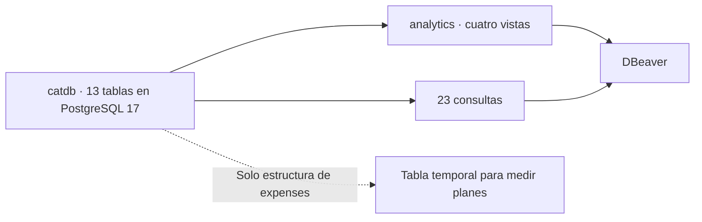

# Arquitectura y procedencia

## Contrato de datos

El esquema `catdb` conserva las tablas, restricciones e índices de CatDB. La base local se llama `catsql`. El esquema `analytics` organiza informes y carece de tablas de hechos propias. La ampliación agrega dos filas de gastos, fechadas en julio de 2030 para probar empates sin alterar los informes del segundo trimestre. Las consultas de cobertura mantienen gatos sin registros con `LEFT JOIN`. La actividad reciente representa el último evento observado y la vista correspondiente contiene exclusivamente gatos con actividad. Los importes están en CLP, los pesos en gramos y los cortes horarios analíticos usan UTC.

| Vista | Grano | Ausencia |
| --- | --- | --- |
| `analytics.expenses_by_cat` | Gato | Cero gastos |
| `analytics.expenses_monthly` | Mes observado | Mes ausente, consulta 06 completa el calendario |
| `analytics.weight_history` | Medición | La primera variación es NULL |
| `analytics.latest_activity` | Gato con actividad | Gato ausente, consulta 19 conserva el catálogo |

La instalación usa una transacción con bloqueo asesor por instancia. La prueba crea otra base en un contenedor sin red ni puertos. Las vistas leen las tablas vigentes y se ordenan explícitamente al consultar si el consumidor requiere un orden concreto. El informe consolidado agrega cada tabla al grano gato antes de unirla.

## Importación de CatDB

Origen exacto [6478aaf106faa590f4b5d1d999827a3fb8170ad3](https://github.com/JonathanKaiKira/catdb-postgresql/tree/6478aaf106faa590f4b5d1d999827a3fb8170ad3). Los archivos `sql/base/01_schema.sql`, `sql/base/02_seed.sql` y `tests/base-integrity.sql` se copiaron sin modificar desde `sql/01_schema.sql`, `sql/02_seed.sql` y `tests/integrity.sql`. Los puntos de entrada Bash y PowerShell derivan de los scripts del mismo commit. Se conserva el aviso MIT de Jonathan Curiñan en [LICENSE](../LICENSE).

Para actualizar, selecciona un commit de CatDB, compara su DDL y muestra con la copia, reemplaza los tres archivos base, actualiza el enlace y valida en una instancia nueva. Revisa manualmente las diferencias de cada salida esperada antes de versionarla. Para instalaciones persistentes, respalda y crea una instancia nueva o diseña una migración explícita.
